<div align="center">

# 👋 Hey, I'm Amirhossein

### But most people call me **Brooklyn** 🗽


<br>


<br>

<picture>
  <source media="(prefers-color-scheme: dark)" srcset="https://raw.githubusercontent.com/AmirhosseinBrooklyn/AmirhosseinBrooklyn/output/pacman-contribution-graph-dark.svg">
  
</picture>

</div>

---

## 🧠 Who Am I?

I'm a Computer Engineering student specializing in **Information Technology**.

For years I've been building things with **PHP**, designing web experiences, solving technical problems, managing products, creating content, writing articles, leading teams, and occasionally turning impossible deadlines into successful launches.

I enjoy creating systems that work, content that matters, and products people actually want to use.

Some people collect hobbies.

I collect skills. 🚀

---

## ⚡ What I Do

| Area | What I Do |
|------|-----------|
| 💻 Development | Backend Development, Web Development, API Integration |
| 🤖 Automation | Telegram Bots, Workflow Automation, Task Systems |
| 📦 Product | Product Management, Project Coordination, Delivery Planning |
| 🎯 Strategy | Prompt Engineering, Content Strategy, Social Media Planning |
| ✍️ Writing | Technical Writing, Blogging, Editing, Proofreading |
| 👥 Leadership | Team Management, Mentoring, Idea Development |
| 🎙️ Creative | Voice Acting, Narration, Dubbing |

---

## 🛠️ Tech Stack

### Core


### Backend & PHP Ecosystem


### Databases


### University / CS Foundations


### CMS & Platforms


---

## 🎯 Beyond Coding

| Skill | Focus |
|------|-------|
| ✍️ Writing | Blogging, long-form writing, personal notes |
| 📚 Editing | Editorial review, proofreading, polishing text |
| 🎯 Prompt Engineering | Structured prompts, AI workflow design |
| 📢 Content Strategy | Planned content for growth and monetization |
| 📈 Social Media | Audience-focused publishing and consistency |
| 🧩 Product Thinking | Idea shaping, prioritization, execution |
| 👨‍💼 Project Supervision | Small-to-large project oversight |
| 🎙️ Voice Work | Voice acting, narration, dubbing |
| 🤝 Team Coordination | Communication, alignment, delivery |
| 💡 Idea Validation | Turning rough ideas into real plans |

---

## 🌎 Find Me Around The Internet

<p align="center">
  <a href="https://github.com/AmirhosseinBrooklyn">
    
  </a>
  <a href="https://t.me/BrooklynThoughts">
    
  </a>
  <a href="https://twitter.com/BrooklynNewGen">
    
  </a>
</p>

---

## 📚 Repositories

⭐ Explore my repositories here:

➡️ **https://github.com/AmirhosseinBrooklyn?tab=repositories**

---

## ☕ Fun Fact

```text
I started learning because I was curious.

Then curiosity became a habit.

Then the habit became a lifestyle.

Now I accidentally learn new things
even when I'm trying to relax.
````
