<!-- Introduction -->

# 👋 Hey, I'm Amirhossein

### But most people call me **Brooklyn** 🗽

  
  
  
  
  

<picture>
  <source media="(prefers-color-scheme: dark)" srcset="https://raw.githubusercontent.com/AmirhosseinBrooklyn/AmirhosseinBrooklyn/output/pacman-contribution-graph-dark.svg">
  
</picture>

---

<!-- About -->

## 🧠 Who Am I?

I'm a **Computer Engineering student specializing in Information Technology**, with a focus on **PHP development, web experiences, and product thinking**.

I build systems, shape ideas into useful products, and turn complex topics into clear content. My work also spans writing, editing, team coordination, and helping projects move from an idea to a launch.

**Curiosity starts it. Craft makes it useful.**

<!-- Toolkit -->

## 🛠️ My Toolkit

**Core stack** — backend, web, and the tools that tie them together.

<picture>
  <source media="(prefers-color-scheme: dark)" srcset="assets/core-icons-dark.svg">
  
</picture>

**Backend & databases**

<picture>
  <source media="(prefers-color-scheme: dark)" srcset="assets/backend-icons-dark.svg">
  
</picture>

**Platforms & languages**

<picture>
  <source media="(prefers-color-scheme: dark)" srcset="assets/platform-icons-dark.svg">
  
</picture>

<strong>Explore the full stack and foundations</strong>

| Area | Tools and foundations |
| :--- | :--- |
| Backend & PHP |         |
| Web |      |
| Databases |       |
| Platforms & mobile |       |
| CS foundations |          |

<!-- Projects -->

## 🚀 Projects & Experiments

## ✨ A Little More About My Work

| I work on | What I bring |
| :--- | :--- |
| **Development & automation** | Backend systems, APIs, Telegram bots, and practical workflows |
| **Product & delivery** | Idea validation, prioritization, coordination, and taking projects to launch |
| **Writing & communication** | Prompt engineering, technical writing, editing, content strategy, and social media |
| **People & creative work** | Team leadership, mentoring, voice acting, narration, and dubbing |

<!-- Profile cards -->

## 🎮 Behind the Profile

<picture>
  <source media="(prefers-color-scheme: dark)" srcset="assets/mindset-dark.svg">
  
</picture>

<!-- Charts -->

## 📊 Code & Collaboration

<picture>
  <source media="(prefers-color-scheme: dark)" srcset="assets/metrics/languages-dark.svg">
  
</picture>
<picture>
  <source media="(prefers-color-scheme: dark)" srcset="assets/metrics/radar-dark.svg">
  
</picture>

Statistics use public data. Language shares are based on code size. The radar covers the past 365 days, with the current public repository count shown separately.

<!-- Contact -->

## 🌎 Let's Connect

  
  
  

<em>Some people collect hobbies. I collect skills.</em> 🚀

